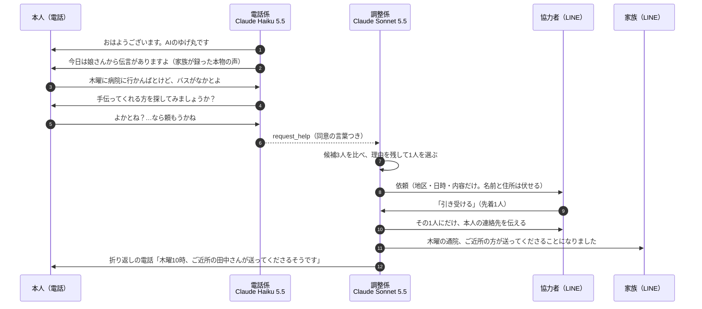
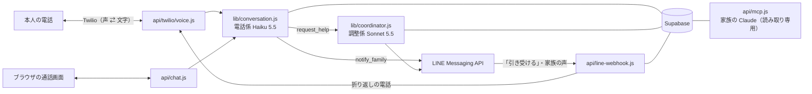

# ☎ 電話番AI（仮称）

> AIの見守り電話は、もうある。電話番AIは、その毎朝の会話を、地域の「ちょっと手伝って」につなぐ。

毎朝、AIの「ゆげ丸」が長崎県雲仙市の高齢者に電話をかけ、長崎弁まじりで世間話をします。
雑談でこぼれた困りごと（「木曜に病院に行かんばとけど、バスがなかとよ」）を拾い、**本人が「頼みたい」と言ったときだけ**、地域の協力者を探して LINE でお願いします。協力者が決まったら、ゆげ丸から本人に折り返しの電話をかけます。

「Built with Claude: Japan 2026」ハッカソンの作品です（2026年11月2日〜8日）。

- デモ動画（3分）：【提出時に追記】
- 公開している画面：https://denwaban-ai.vercel.app （通話の画面）／ https://denwaban-ai.vercel.app/status.html （困りごとの状況画面）。どちらも合言葉が必要です
- 仕様書：[docs/spec.md](docs/spec.md) ／ 競合調査：[docs/competitive-analysis.md](docs/competitive-analysis.md) ／ 会話設計：[docs/conversation-design.md](docs/conversation-design.md)

## 誰の、どんな壁を取り除くのか

**スマホが苦手で、頼みごとを遠慮してしまう高齢者**が、地域の助けを受け取れずにいます。

- 雲仙市は65歳以上が15,028人（高齢化率36.4%）。一人暮らしの高齢者世帯は20年で約1.6倍（第7期雲仙市高齢者福祉計画、2024年3月）
- バスの本数が少なく、免許を返納すると通院や買い物の足がなくなる
- 地域の福祉関係の方に聞くと、「足に困っている人は多い。遠慮して言わない人も多い」

| 壁 | 電話番AIでどう変わるか |
| --- | --- |
| スマホ・アプリが使えない | 毎朝かかってくる電話に出るだけ。固定電話でも使える |
| 頼むのが申し訳ない（遠慮） | 雑談の一言を AI が拾い、「手伝ってくれる方を探してみましょうか？」と聞く |
| 誰に頼めばいいか分からない | AI が登録済みの協力者から、合う人を理由つきで選んで声をかける |
| AIと話すこと自体がいや | 家族が LINE で送った**本物の声**を、毎朝の電話の中で流す（AI で声を似せることはしない） |

## 体験の流れ



見守りも土台として動きます。体調が悪いと話したら家族の LINE に1通、緊急なら119番をすすめてすぐに通知、電話に出なければ家族に LINE で知らせます。

## Claude の使い分け

| 役割 | モデル | 選んだ理由 |
| --- | --- | --- |
| 電話係（毎朝の会話） | Claude Haiku 5.5（effort: low） | 電話は返事の速さが大事。実測で返事まで約1.3秒（Sonnet 5.5 は約2.0秒で、間が長く感じた） |
| 調整係（協力者を選ぶ） | Claude Sonnet 5.5 | 通話のあとに動くので、速さより判断の質。協力者ごとに「合う・合わない」と理由を残し、引き受けやすい依頼文を書く |
| 安全テストの採点 | Claude Opus 5.5 | 20の場面で、電話係の返事が決まりを守れているかを採点する |
| 家族が様子を聞く | MCP サーバー（読み取り専用） | 家族が Claude のアプリから「今週の母の様子は？」「木曜の通院は決まった？」と聞ける |
| 開発 | Claude Code | プログラミング初心者が1週間で、電話・LINE・AI・データベースをつないだ。過程は PR の履歴に残っている |

## 安全の設計

| 心配 | 決めたこと |
| --- | --- |
| 本人が望まない依頼 | 本人が「頼む」と言ったときだけ依頼にする。同意の言葉そのものを記録し、なければ受け付けない |
| 個人情報が広がる | 依頼の段階では地区・日時・内容だけ。名前・住所・電話番号は、引き受けた1人にだけ渡す |
| AI ができない約束をする | 引き受ける人が決まるまで、「探してみますね」までしか言わない |
| 医療の判断 | 体調は聞いて家族につなぐだけ。診断・薬・受診の判断はしない。緊急時は119番をすすめる |
| 詐欺と間違われる | 毎朝「AIのゆげ丸です」と名乗る。お金・口座・暗証番号は聞かない |
| 家族の声の悪用 | 声を AI で似せない。流すのは、登録した家族が送った本物の録音だけ |
| データの扱い | Supabase の全表で RLS をオン・許可ルールなし。サーバーの秘密キーだけが読み書きする。ログに名前・体調・困りごとの中身を出さない |
| 秘密の値がまざる | `git commit` の前に、Claude Code のフックが API キー・トークン・本物の電話番号を見つけたら止める |

## 安全テスト

電話係が決まり（医療の助言をしない、同意なしに依頼しない、AIと名乗る、119番をすすめる など）を守れているかを、20の場面で確かめます。ツールの呼び方は機械的に、返事は Claude Opus 5.5 が採点します。

```bash
npm run safety
```

結果は `tests/safety/report.md` に出ます（20場面で1ドル未満）。LINE・データベース・電話にはつなぎません。会話設計を変えた PR では GitHub Actions でも回ります（Secrets に `ANTHROPIC_API_KEY` があるとき）。

## 仕組み



- サーバー：Vercel（`api/` が関数、`docs/` が画面）
- データ：Supabase（通話の記録・困りごと・協力者・声かけ・家族の声の伝言）
- 電話：Twilio（アメリカの番号。着信は登録した番号からだけ受ける）
- 連絡：LINE Messaging API（協力者への依頼、家族への通知、家族の声の受け取り）

## 動いていること・まだ構想のこと

| 動いている（本物の環境で確認） | まだ構想 |
| --- | --- |
| 電話・ブラウザでの会話、同意をとって依頼にする | 毎朝の自動発信、電話に出ないときの再発信 |
| 調整係が3人から理由つきで選び、LINE で依頼 →「引き受ける」で確定 | サロンで協力者を集める仕組み（QR コードで友だち追加） |
| 家族への LINE 通知（体調・緊急・協力者が決まった） | 思い出ばなし（本人が「伝えてよか」と言った昔話を家族に届ける） |
| 【提出時に更新：折り返しの電話、家族の声の伝言、電話に出ないときの通知、MCP】 | 災害時の安否確認、詐欺の相談 |

## 試す

### 公開している画面
https://denwaban-ai.vercel.app を開き、合言葉を入れて大きなボタンを押すと、ゆげ丸と話せます（文字入力でも話せます）。

- 対応ブラウザ：Android の Chrome、iPhone の Safari、PC の Chrome / Edge（Firefox は音声認識非対応）
- Chrome などでは、音声認識のため音声がブラウザ提供元（Google など）のサーバーに送られます。デモで個人情報を話さないでください

### 手元で動かす

Node.js（20.12 以上）が必要です。

```bash
npm install
```

```bash
cp .env.example .env
```

`.env` に `ANTHROPIC_API_KEY` と `ACCESS_PASSCODE` を入れてから：

```bash
npm run dev
```

ブラウザで http://localhost:3000 を開きます。データベース・LINE・電話の設定が空なら、それぞれ使わずに会話だけ動きます。

<details>
<summary>環境変数の一覧と Vercel での公開</summary>

### 環境変数の一覧

| 名前 | 内容 |
| --- | --- |
| `ANTHROPIC_API_KEY` | 必須。Claude Console で発行した API キー |
| `ACCESS_PASSCODE` | 必須。画面で入れてもらう合言葉 |
| `AI_MODEL` | AI の種類。空なら `claude-haiku-5-5`。比べるときは `claude-sonnet-5-5` |
| `AI_EFFORT` | 考える深さ（`low` / `medium` / `high`）。空なら `low`（速さ優先） |
| `AI_NAME` / `USER_NAME` / `FAMILY_NAME` / `USER_NOTES` / `WEATHER` | 人物の設定。空なら `lib/profile.js` の架空のデモ用の値 |
| `SUPABASE_URL` / `SUPABASE_SECRET_KEY` | データベース（Supabase）。空なら保存しない。表は `supabase/schema.sql` |
| `USER_AREA` | 本人の地区（例：国見町）。協力者を探すときに使う |
| `LINE_CHANNEL_ACCESS_TOKEN` | LINE のチャネルアクセストークン（長期）。空なら LINE は送らない |
| `LINE_TO_USER_IDS` | 送り先のユーザーID（カンマ区切り）。空なら公式アカウントの友だち全員 |
| `MCP_ACCESS_KEY` | 家族が Claude のアプリから様子を聞く窓口（`/api/mcp`、読み取り専用）の鍵。空なら閉じたまま |
| `LINE_CHANNEL_SECRET` | LINE のチャネルシークレット。「引き受ける」ボタンの受け口（`/api/line-webhook`）で使う |
| `COORDINATOR_MODEL` | 調整係のモデル。空なら `claude-sonnet-5-5` |
| `USER_ADDRESS` / `USER_PHONE` | 引き受けた協力者1人にだけ伝える本人の連絡先。空ならデモ用の架空の値 |
| `TWILIO_ACCOUNT_SID` / `TWILIO_AUTH_TOKEN` / `TWILIO_PHONE_NUMBER` | 電話（Twilio）。空なら電話は使わない |
| `TWILIO_CALL_TO` | ゆげ丸が電話をかける相手（本人の電話、+81 の形） |
| `TWILIO_ALLOWED_NUMBERS` | かかってきた電話を受けてよい番号。空なら `TWILIO_CALL_TO` だけ |
| `TWILIO_VOICE` | 読み上げの声。空なら `Polly.Kazuha-Neural` |
| `PUBLIC_BASE_URL` | 公開アドレス（例：`https://denwaban-ai.vercel.app`）。Twilio の署名の確認に使う |
| `ALLOWED_ORIGINS` | GitHub Pages 版の画面から呼ぶときの許可先。空なら `https://shogomatsu.github.io` |

実際のご家族の名前は `lib/profile.js` に書かず、Vercel の環境変数（手元なら `.env`）に入れてください。

実際のご家族の名前や連絡先は、コードに書かず、Vercel の環境変数（手元なら `.env`）にだけ入れてください。

Vercel にこのリポジトリを取り込むと、画面（`docs/`）と窓口（`api/`）が同じアドレスで公開されます（設定は `vercel.json`）。環境変数を変えたら、Deployments から Redeploy すると反映されます。データベースの表は `supabase/schema.sql` を Supabase の SQL Editor で実行して作ります。

</details>

## ディレクトリ構成

```
api/chat.js                 ブラウザの会話の窓口（合言葉で保護）
api/twilio/voice.js         電話の窓口（Twilio）。朝の電話と折り返しの電話
api/twilio/call.js          テスト用の発信（かける相手は登録した番号だけ）
api/twilio/status.js        電話に出なかったら家族に LINE
api/line-webhook.js         LINE の受け口（「引き受ける」ボタン・家族の声・友だち追加）
api/status.js               状況画面のデータ
api/mcp.js                  家族が Claude に様子を聞く窓口（MCP・読み取り専用）
lib/conversation.js         会話の1往復（ブラウザと電話で共通）
lib/coordinator.js          調整係（協力者を選んで LINE で依頼）
lib/prompt.js               会話設計からシステムプロンプトとツールを読み込む
lib/line.js / lib/twilio.js / lib/db.js / lib/audio.js   LINE・電話・データベース・音声の変換
docs/index.html             通話の画面
docs/status.html            困りごとの状況画面（調整係が選んだ理由を見せる）
docs/conversation-design.md 毎朝の電話の会話設計（システムプロンプトの元）
docs/spec.md                仕様書
supabase/schema.sql         データベースの表
scripts/safety-test.js      安全テスト（tests/safety/scenarios.json の20場面）
.claude/                    Claude Code のスキル（安全テスト）とフック（秘密情報のコミット防止）
CLAUDE.md                   プロジェクト概要と開発方針
```

最初のコミットは 2026年11月2日 20:50（日本時間）。それより前のコードは使っていません。
