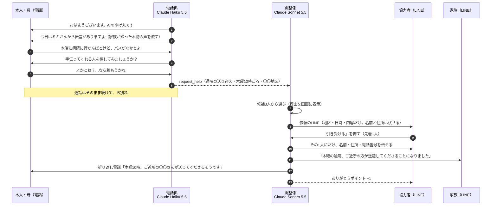

# 電話番AI 仕様書（v2.3・2026年11月6日）

> AIの見守り電話は、もうある。電話番AIは、その毎朝の会話を、地域の「ちょっと手伝って」につなぐ。

v1（毎朝の見守り電話＋家族への通知）から、**主役を「地域の助け合いのマッチング」に移した**版です。
見守り電話は2026年だけで6サービスが出ていて、そこでは差がつきません（[競合調査](./competitive-analysis.md)）。

v2.1 では、審査を想定したフィードバックをもとに、次の5点を直しました。
1. 協力者を、社会福祉協議会などの**すでにいる担い手**と位置付けた
2. 依頼にする前に、**本人の同意**を電話の中で取る
3. 調整係が**3人の候補から選ぶ理由**を、画面に見せる
4. 作る順番を決め、Claude Code の説明は1行にまとめた。MCP は読み取り専用・時間を区切って残す
5. 着信は「ゆげ丸」と表示させ、協力者を母が演じていることは字幕で明かす

v2.2 では、実際に話を聞いて試した結果を反映しました。
1. **地域の福祉関係の方に電話で聞いた**：送迎の仕組みは市としてはない。遠慮して言わない人も多い。「使えそう。ただ、ボランティアを集める仕組みがない」（§1）
2. **父にテストを断られた**：「AIなんかと話すか」。AIに話しかけること自体に抵抗がある人がいる（高齢の男性に多いのでは、という仮説）。これを正面から扱う工夫として「家族の声の伝言」を作る順に入れた（§1・§6）
3. **母は楽しそうに話した**：本人役は母にする。所感（合言葉が見つけにくい、毎回ボタンを押し忘れる、返事が長い）は画面と話し方に反映済み

v2.3 では、地域の福祉関係の方に**試作の動画を見ていただいた感想**（11/6、メール）を反映しました（§1）。
1. **本人はAIの電話を完全無料で使えるようにする**（費用は自治体・福祉団体からの委託。§5）
2. **協力者はボランティアが基本**。収入につながるものではないことを、登録のときに説明する（§4）
3. **送迎などの実費は、市内一律の目安を決めて、本人と協力者の間で**。サービスはお金を扱わない（§4）
4. **耳が遠い方など、電話が難しい方は使えない**。対象が限られることを正直に書き、そういう方は今までの見守り（訪問・民生委員）につなぐ（§1）

---

## 1. 誰の、どんな壁を取り除くのか（テーマ2）

**雲仙市でスマホが苦手な高齢者**が、助けを受け取れずにいる。

- 雲仙市は65歳以上が15,028人（高齢化率36.4%）。一人暮らしの高齢者世帯は2,156世帯で、20年で約1.6倍（第7期雲仙市高齢者福祉計画、2024年3月）
- バスの本数が少なく、免許を返納すると通院や買い物の足がなくなる

| 壁（強い順） | いまの状態 | 電話番AIでどう変わるか |
| --- | --- | --- |
| ① スマホ・アプリが使えない | 地域の助け合いの仕組みがあっても、アプリや LINE が前提だと届かない | **毎朝かかってくる電話に出るだけ**。固定電話でも使える |
| ② 頼むのが申し訳ない（遠慮） | 「病院に行かんばとけど…」と思っても、自分からは頼まない | 雑談でこぼした一言を AI が拾い、**「手伝ってくれる人を探してみましょうか？」と聞く** |
| ③ 誰に頼めばいいか分からない | 手伝える人が近くにいても知らない | **AI が登録済みの協力者から、合う人を探して声をかける** |

### 地域の福祉関係の方に聞いたこと（11/4、電話）
発表では、先方の希望により「地域の福祉関係の方」として紹介する（団体名・お名前は出さない）。

| 聞いたこと | 答え |
| --- | --- |
| 通院や買い物の足に困っている人は | **多い**。送迎の仕組みは市としてはない。民間の送迎、コンビニの移動販売、乗合タクシーなどがある |
| 遠慮して言わない人は | **そういう人も多い** |
| 情報が届いていない人は | いそう。情報は市の広報誌や、市役所に貼っている案内で伝えている |
| いまの体制 | 生活支援コーディネーターは**2人で市内全域**。自治会のサロン（公民館でのレクリエーションなど）で声を聞いている。困りごとは国見町・瑞穂町に多い |
| 電話番AIは | **「使えそう。ただ、ボランティアの人を集める仕組みがない。詐欺や個人情報も気になる」** |
| ボランティア活動保険 | 入れる。1日28円で、入院の保障は3,500円。ボランティアには必ず入ってもらっている |
| ボランティアの登録 | 名前・生年月日・住所・電話番号を受け付けている。本人確認書類はもらっていない |
| いまのボランティア活動 | 視覚障害のある方の生活支援、サロンでの食事作りなど。送迎はしていない |

### 協力者はどこから来るのか（v2.2で見直し）
「すでにいる担い手の道具になる」は変えない。ただし、**地域の福祉団体にも、協力者を集める仕組みはない**と分かった。そこで、集めるところまでを電話番AIの役目にする。

1. **サロンを入口にする**：生活支援コーディネーターが回っている自治会のサロンで、「ちょっと手伝える人」に LINE の友だち追加をしてもらう（QRコードを配る）
2. **登録は地域の福祉団体のボランティア登録と同じ項目**：名前・生年月日・住所・電話番号。**ボランティア活動保険への加入を、登録の条件にする**
3. **頼むのは小さなことから**：送迎だけでなく、「買い物ついでに牛乳を1本」「電球の交換」など、近所の人が5分でできること
4. **既存の手段も案内する**：協力者が見つからないときは、乗合タクシーや移動販売の日時を案内する（構想）

言い方：「電話番AIは、2人で全域を回るコーディネーターの代わりに、毎朝すべての家の困りごとを聞き取り、サロンで集まった協力者につなぐ」

### 試作の動画を見ていただいた感想（11/6、メール）
地域の福祉関係の方に、母が本人役をした試作の動画（約5分）を見ていただいた。発表では団体名・お名前は出さない。

| 聞いたこと | いただいた感想 | どうするか |
| --- | --- | --- |
| 実際に使うときの課題 | AIとの会話に慣れるまで時間がかかる方もいる。耳が遠い方など、電話でのやり取りが難しい方もいて、使える方は限られるのでは | **対象が限られることを正直に書く**。慣れるまでは、家族の紹介と家族の声の伝言で入りやすくする。読み上げをもっとゆっくり・大きくする（構想）。電話が難しい方は、今までの見守り（訪問・民生委員）につなぐ |
| 協力者にお願いするときの注意 | 個人情報の取り扱いに十分注意してほしい。協力者は地域のボランティアが基本。協力することが収入につながるという考えにならないよう、事前に十分な説明が必要 | 個人情報は引き受けた1人にだけ（作成済み）。**登録のときに「ボランティアで、収入にはならない」と説明する**。ありがとうポイントはお金にしない |
| 「これがあれば使える」 | 現時点では、特にない | 「使える」と言ってもらえる形はまだない。次は、サロンで少人数に試してもらい、何があれば使えるかを一緒に探す |
| その他（お金） | AIとの電話は、気軽に使えるよう**完全無料**にしてほしい。協力者が対応するときの費用は、本人と協力者の間で、**雲仙市内で一律**に決める形がよい | **本人は完全無料**（委託で運営。§5）。実費の目安を市内一律で決め、受け渡しは本人と協力者の間で。サービスはお金を扱わない。実費を超える対価になると、送迎は道路運送法の許可が要るおそれがあるので、目安は「実費の範囲」にとどめる（要確認） |

### 裏付け
| 主張 | 裏付け | 状態 |
| --- | --- | --- |
| 足に困っている人が多い・遠慮して言わない | 地域の福祉関係の方の声（上の表） | **取れた** |
| 手伝える人は近所にいる | 社内アンケート：**73%**が「近所の高齢の方の買い物や送迎を手伝ってもいい」（思う15%＋条件しだいで58%） | 途中経過（26人） |
| 遠慮して頼まない | 社内アンケート：高齢の家族がいる人の**50%**が「親は困っても遠慮して頼まなそう」（「頼める相手がいない」を足すと54%） | 途中経過（24人） |
| スマホより電話 | 社内アンケート：**42%**が「親は電話に出るだけ、または固定電話だけ」 | 途中経過（24人） |
| AI と話すのを嫌がる人がいる | 社内アンケート：気になる点の**1位**が「AIと話すのを嫌がりそう」（54%） | 途中経過（26人） |
| 担い手が使ってくれる | 「使えそう」の一言。11/6 の午前に試作の動画を送り、5分見てもらって感想をもらう | 動画を送る約束済み |

### AI と話すのを嫌がる人（父の学び）
父にテストを頼んだら、「AIなんかと話すか」と断られた。母は楽しそうに話したので、「AIに話しかけること」への抵抗は人によって大きく違う。社内アンケートでも、気になる点の1位は「AIと話すのを嫌がりそう」（54%）だった。自由記述にも「見守る側の声も登録して、祖父母に届けられたらいい」という声があり、家族の声の伝言はこれに応える。

- **「AIと話す電話」ではなく、「家族の声が届く電話」にする**：子や孫が LINE のボイスメッセージで送った**本物の声**を、毎朝の電話の中で流す（「今日は、ミキさんから伝言がありますよ」）。本人が電話に出る理由になる
- **声をAIで似せることはしない**：家族の声をAIで作ると、オレオレ詐欺の手口を後押ししかねず、「AIであることを隠さない」方針とも矛盾する。流すのは、家族が自分で録った声だけ
- **家族からの紹介**：最初の電話は、家族が「娘のミキに頼まれて電話しています」と言える形で始める（会話設計どおり）
- **話は短く**：1回の返事は1文・30文字まで（母の所感を反映）

### 登場人物
| 役 | デモでの人 | 使うもの |
| --- | --- | --- |
| 本人 | **母（65歳、雲仙市）**。実際に試して、楽しそうに話した | 電話だけ。スマホの連絡先に「ゆげ丸」を登録しておく |
| 家族 | 離れて暮らす姉夫婦 | LINE（通知と報告を受け取る。ボイスメッセージで伝言を送る） |
| 協力者 | 自分が演じる（**字幕で「協力者役：本人の息子」と明示**）。候補として架空の2人も登録 | LINE（依頼を受けて「引き受ける」を押す） |
| 父（68歳） | 「AIなんかと話すか」と断った人。デモの最後に正直に登場 | ― |

---

## 2. 体験の流れ（主役はB）

### A. 毎朝の電話（電話係）
- 流れはv1と同じ：あいさつ → 体調 → 今日の予定 →（望めば）雑談 → お別れ。全体で1〜2分
- **困りごとが出たら、まず本人に聞く**：「手伝ってくれる人を探してみましょうか？」
  - 「よか」と言われたら、「何を・いつ・どこへ」を1つずつ聞いて `request_help` を呼ぶ
  - 「いらん」「悪かけん」と言われたら、無理に勧めない。依頼にはしない（記録だけ残す）
  - 言い方は「探してみますね。見つかったらお知らせしますね」まで。**引き受ける人が決まるまでは約束しない**
- 体調の話は今までどおり `notify_family`。緊急時は119番をすすめて、すぐに通知する

### B. 段取り（調整係・通話のあと）
1. 依頼の中身と、登録済みの協力者（できること・地区・空いている曜日）を照らし合わせ、**声をかける1人を選び、理由を書く**
   - 例：「Aさんは木曜が空いていない。Bさんは車がなく送迎できない。Cさんは同じ地区で木曜の午前が空いている → Cさん」
   - 選んだ理由と依頼文は、状況画面に表示する（デモで「Claudeが考えている」ことを見せる）
2. 協力者向けの依頼文を書いて、LINE で送る。「引き受ける」「今回は難しい」のボタンを付ける
3. 「引き受ける」で確定。「今回は難しい」なら、次の候補に声をかける
4. 確定した1人にだけ、本人の名前・住所・電話番号を送る
5. 家族に LINE で報告する
6. ゆげ丸から本人に**折り返し電話**をかけて伝える。間に合わなければ、**翌朝の電話で伝える**
7. 協力者に「ありがとうポイント」を1つ付ける
8. 全員が難しければ、家族に「見つかりませんでした」と LINE で相談する

### C. 見守りの通知（v1のまま・作成済み）
- 「体調が悪い」と言った → 通話のあと家族に1通。緊急 → その場ですぐ

### D. 家族が Claude に様子を聞ける（MCP・軽く）
- 通話の記録と依頼の状況を**読むだけ**の MCP サーバー。ツールは2つ（最近の通話のまとめ／困りごとの状況）
- 家族が Claude のアプリから「今週の母の様子は？」「木曜の通院は決まった？」と聞ける
- **作業は2時間で区切る。** 動かなければ構想として触れるだけにする

---

## 3. Claude の使い分け

| 役割 | 使うもの | 選んだ理由 |
| --- | --- | --- |
| 電話係 | Claude Haiku 5.5（effort: low） | 電話は返事の速さが大事。実測で約1.3秒（Sonnet 5.5 は約2.0秒で、間が長く感じた） |
| 調整係 | Claude Sonnet 5.5 ＋ ツール（候補を調べる・LINE を送る・家族に報告・折り返し電話） | 通話のあとに動くので、速さより判断の質を優先。誰に頼むか、どう書けば引き受けやすいかを考え、理由を残す |
| 安全テスト | テスト用の場面（まず20件）＋ Claude で採点 | 「医療の助言をしない」「119番をすすめる」「同意なしに依頼しない」「約束しない」「個人情報を聞かない」を毎回自動で確かめる |
| 様子を聞く | MCP サーバー（読み取り専用） | §2-D |
| 開発 | Claude Code | 「プログラミング初心者の自分が5日で、電話・LINE・AIをつなぐシステムを作れた。その過程は PR の履歴に残っている」 |

---

## 4. 安全の設計

| 心配 | 決めたこと |
| --- | --- |
| 本人が望まない依頼 | **本人が「頼む」と言ったときだけ**依頼にする。断られたら勧めない |
| 知らない人が家に来る | 協力者の登録は地域の福祉団体と同じ項目（名前・生年月日・住所・電話番号）。**ボランティア活動保険への加入を登録の条件にする**。デモは家族が演じる |
| 個人情報が広がる | 依頼の段階では地区・日時・内容だけ。**名前・住所・電話番号は、引き受けた1人にだけ**渡す |
| 送迎と法律 | 送迎は**無償**（ガソリン代などの実費のみ）。一般の人が対価を受けて送迎すると道路運送法の許可が要るおそれがあるため、**ありがとうポイントを地域通貨にするときは送迎を対象外にするか、法律を確認する**（要確認） |
| 事故のとき | ボランティア活動保険（1日28円、入院の保障3,500円。地域の福祉団体ではボランティアに必ず入ってもらっている）を前提にする |
| 協力者の報酬 | 地域のボランティアが基本。**協力しても収入にはならない**ことを、登録のときに説明する。ありがとうポイントはお金にしない（福祉関係の方の意見） |
| 送迎などの実費 | ガソリン代などの実費の目安を**市内一律**で決め、受け渡しは本人と協力者の間で。サービスはお金を扱わない（福祉関係の方の意見。法律の扱いは要確認） |
| 家族の声の悪用 | 声を AI で似せない。流すのは、登録済みの家族が LINE で送った本物の録音だけ |
| お金のトラブル | お金の受け渡しはサービスが扱わない |
| AI ができない約束をする | 引き受ける人が決まるまで、AI は「探してみますね」までしか言わない |
| 医療の判断 | 体調の話は聞いて家族につなぐだけ。診断・薬・受診の判断はしない。緊急時は119番 |
| 詐欺と間違われる | AI であることを毎朝名乗る。お金・口座・暗証番号は聞かない。デモの着信は「ゆげ丸」と表示させる（アメリカの番号からかかるため） |
| テスト中の誤送信 | LINE の送り先を環境変数で絞る（家族・協力者ごとにユーザーIDを登録） |

---

### 社内アンケートで分かった、そのほかのこと（途中経過26人）
- 役に立ちそうな機能は、体調を家族に知らせる（85%）、**災害時の安否確認（81%）**、電話に出ないときに知らせる（62%）、困りごとを地域へつなぐ（50%）の順。マッチングは主役だが、人気では4位。デモでは「なぜ必要か」を福祉関係の方の声と「遠慮」の数字で先に示す
- 「電話に出ないときに知らせる」は62%が望んでいる。後回しにしていたが、再発信なしの通知だけなら小さく作れる（§6）
- 「毎日あちこち具合が悪いと届くと、受け取る側が疲れそう」という声 → 体調の通知は通話ごとに1通にまとめている。週に1回のまとめも構想にする
- 認知症の家族を心配する声が3件。「話がかみ合わない」は緊急のサインとして扱っている（診断はしない）
- 「明るい話題も聞いてほしい」「毎朝聞いてほしいこと（薬を飲んだか など）を家族が決められるとよい」→ 構想

## 5. お金の回り方
- 原価は1人あたり月1,800〜3,300円（毎日3分。大半は通話料。[競合調査](./competitive-analysis.md)）
- **本人（高齢者）は、AIの電話を完全無料で使える**ようにする。AIにお金がかかると利用をためらう方が出る、という福祉関係の方の意見から
- 払うのは**自治体や社協からの委託**を基本にする（郵便局の見守りは自治体の交付金で導入された例がある）
- 家族が払う月額プランは、Care-Call.AI（3,980円〜）と同じか少し下
- ただし社内アンケートでは、月に払えるのは「1,000円まで」が65%。家族の負担だけでは原価をまかなえないので、**自治体・社協からの委託が基本**という考えを裏付けた

---

## 6. 作る順番（上から必ず動かす）

| 順 | 内容 | 間に合わないとき |
| --- | --- | --- |
| 1 | 電話の中で同意を取り、`request_help` で依頼にする | ―（ここは必須） |
| 2 | 調整係が3人の候補から選び、理由と依頼文を残す。協力者に LINE で依頼が届き、「引き受ける」を押せる | ― |
| 3 | 家族に LINE で報告。状況画面に選んだ理由を表示 | 報告は画面だけ |
| 4 | Twilio で電話につなぐ（着信は「ゆげ丸」表示） | ブラウザの通話画面で見せる |
| 5 | 折り返し電話 | 翌朝の電話で伝える |
| 6 | 安全テスト（20件。`npm run safety`）。**コード済み** | 件数を減らす |
| 7 | **家族の声の伝言**：家族が LINE で送ったボイスメッセージを、次の朝の電話で流す（AI と話すのを嫌がる人のため）。**コード済み** | 録音を画面で流して見せる |
| 8 | MCP（読み取り専用。`api/mcp.js`）。**コード済み** | 構想として触れる |
| 済 | 体調の見守り通知（v1）。母の所感の反映（合言葉は全画面、話し終わったら自動で聞く、返事は1文・30文字） | ― |
| 済 | 電話に出ないとき（出ない・話し中）に家族へ LINE（再発信はしない）。社内アンケートで62%が望んだため前倒し | ― |
| 後回し | 電話に出ないときの再発信、毎朝の自動発信 | デモでは手でかける |
| 構想のみ | 思い出ばなし（§8）、詐欺の相談、災害時の安否確認、地域通貨 | ― |

### データ（Supabase）
- `calls`：通話の記録（体調・予定・まとめ）
- `help_requests`：困りごと（内容・日時・場所・同意の有無・状態：探している／決まった／見つからない）
- `helpers`：協力者（呼び名・できること・地区・空いている曜日・LINE のユーザーID・ポイント）
- `offers`：誰に声をかけたか、選んだ理由、返事（引き受ける／難しい）

---

## 7. デモ動画（3分）

| 時間 | 場面 | 見せたいこと |
| --- | --- | --- |
| 0:00〜0:20 | 母の暮らし。バスは少ない、スマホは苦手。雲仙市の数字。福祉関係の方の声「足に困っている人は多い。遠慮して言わない人も多い」 | 誰の、どんな壁か |
| 0:20〜0:45 | 朝、母の電話に「ゆげ丸」から着信。姉からの伝言（本物の声）が流れて、母が笑う。「腰が痛か」→ 姉の LINE に届く | 見守りと「家族の声が届く電話」 |
| 0:45〜2:05 | 「木曜に病院に行かんばとけど…」→「探してみましょうか？」→「よかとね？…なら頼もうかね」→ 調整係が3人から選ぶ理由が画面に → 協力者（字幕：協力者役・息子）の LINE に依頼 →「引き受ける」→ 姉に報告 → ゆげ丸から母に折り返し電話 | **主役。遠慮の壁を越える瞬間** |
| 2:05〜2:35 | 電話係（Haiku・1.3秒）と調整係（Sonnet）の図。安全テストの結果。家族が Claude に「今週の母は？」と聞く場面（MCP） | Claude の活用 |
| 2:35〜3:00 | 正直な話：「実は、父には『AIなんかと話すか』と断られました」→ だから「AIと話す電話」ではなく「家族の声が届く電話」にした → 福祉関係の方の「使えそう。でも協力者を集める仕組みがない」→ サロンから協力者を集める絵 → 「次は、娘の声で父をもう一度誘います」 | 試行錯誤の跡と、ハッカソン後も続く形 |

- 父の話は、失敗で終わらせず「だから次はこうする」で締める
- 思い出ばなし（§8）は、時間があれば最後に一言だけ触れる

---

## 8. 思い出ばなし（構想・デモの最後で触れる）

毎朝の雑談で出た昔の話や暮らしの知恵を、**本人が「家族に伝えてよか」と言ったものだけ**、家族に届ける。

- 毎朝の電話が「見守られる時間」から「話を聞いてもらえる時間」になり、本人が電話に出る理由が増える（続けて使ってもらえる理由）
- 家族にとっては、離れていても親や祖父母の話が残っていく。子や孫が家族向けの月額を払う理由にもなる
- 流れ：
  1. 雑談で本人が昔の話をしたときだけ、聞き役になる。こちらから無理に聞き出さない
  2. 話が一区切りついたら、AI が「いまのお話、ご家族にお伝えしてもよかですか？」と聞く
  3. 「よか」なら、短くまとめて家族の LINE に「思い出ばなし」として送る（本人の言葉をなるべくそのまま）
  4. 「いかん」「恥ずかしか」なら、**保存しない**。次の電話でもこちらから触れない
- 健康や家族の悩みなど、つらい話は思い出ばなしにしない（見守りのほうで扱う）
- MCP（§2-D）とつながる：家族が Claude に「母の若いころの話を聞かせて」と聞ける（伝えてよいと言われた話だけ）

## 9. まだ決めていないこと・確かめること
- 送迎と道路運送法の扱い（実費のみなら許可は要らない、という整理で合っているか）
- サロンで協力者を集める方法（QRコードを配る、コーディネーターに紹介してもらう）
- 11/6 午前に、福祉関係の方へ試作の動画を送る（ブラウザ版の画面録画）
- 父にもう一度：家族の声の伝言ができたら、姉の声で誘ってみる（無理はしない）
- Twilio（アメリカの番号）から日本の携帯に電話が届くか（早めに1回試す）
- サービス名：社内アンケートでは「見守りコール」が50%で1位（途中経過）。「高齢者から見て気が引けない名前がいい」という声もあるので、最終結果を見て決める
