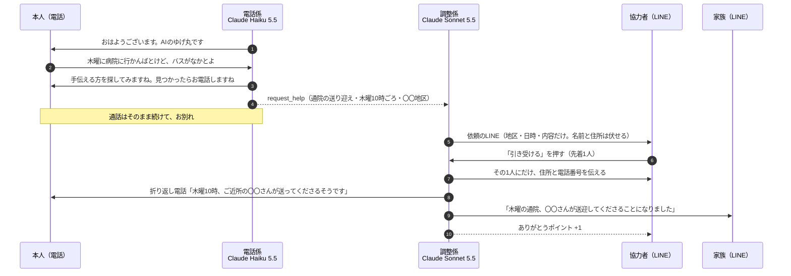

# 電話番AI 仕様書（v2・2026年11月3日）

> AIの見守り電話は、もうある。電話番AIは、その毎朝の会話を、地域の「ちょっと手伝って」につなぐ。

v1（毎朝の見守り電話＋家族への通知）から、**主役を「地域の助け合いのマッチング」に移した**版です。
見守り電話は2026年だけで6サービスが出ていて、そこでは差がつきません（[競合調査](./competitive-analysis.md)）。

---

## 1. 誰の、どんな壁を取り除くのか（テーマ2）

**雲仙市でスマホが苦手な高齢者**が、助けを受け取れずにいる。

- 雲仙市は65歳以上が15,028人（高齢化率36.4%）。一人暮らしの高齢者世帯は2,156世帯で、20年で約1.6倍（第7期雲仙市高齢者福祉計画、2024年3月）
- バスの本数が少なく、免許を返納すると通院や買い物の足がなくなる
- 手伝える人は近所にいるのに、つながる手段がない

| 壁（強い順） | いまの状態 | 電話番AIでどう変わるか |
| --- | --- | --- |
| ① スマホ・アプリが使えない | 地域の助け合いアプリや LINE の仕組みがあっても届かない | **毎朝かかってくる電話に出るだけ**。固定電話でも使える |
| ② 頼むのが申し訳ない（遠慮） | 「病院に行かんばとけど…」と思っても、自分からは頼まない | 雑談の中でこぼした一言を **AI が拾って、頼みごとに変える** |
| ③ 誰に頼めばいいか分からない | 手伝える人が近くにいても知らない | **AI が登録済みの協力者を探して、声をかける** |

### 登場人物（デモでは実在の家族が演じる）

| 役 | デモでの人 | 使うもの |
| --- | --- | --- |
| 本人 | 父（68歳、雲仙市） | 電話だけ |
| 家族 | 離れて暮らす姉夫婦 | LINE（通知を受け取る） |
| 協力者 | 母が「ご近所の協力者」役（名前は架空） | LINE（依頼を受けて「引き受ける」を押す） |
| 民生委員 | 構想として登場 | Claude に様子を聞く（§4-D） |

---

## 2. 体験の流れ（主役はB）

### A. 毎朝の電話（電話係）
- 流れはv1と同じ：あいさつ → 体調 → 今日の予定 →（望めば）雑談 → お別れ。全体で1〜2分
- **新しく、困りごとの聞き取りを `request_help` ツールで依頼に変える**
  - 聞くのは「何を・いつ・どこへ」だけ。1回に1つずつ聞く
  - 言い方は「手伝える方を探してみますね。見つかったらお電話しますね」まで。**引き受ける人が決まるまでは約束しない**
- 体調の話は今までどおり `notify_family`。緊急時は119番をすすめて、すぐに通知する

### B. 段取り（調整係・通話のあと）
1. 依頼の中身と、登録済みの協力者の一覧（できること・地区・空いている曜日）から、声をかける人を選ぶ（最大3人）
2. 協力者向けの依頼文を書いて、LINE で送る。「引き受ける」「今回は難しい」のボタンを付ける
3. 最初に「引き受ける」を押した1人で確定する。ほかの人には「ほかの方が引き受けてくださいました」と送る
4. 確定した1人にだけ、本人の名前・住所・電話番号を送る
5. ゆげ丸から本人に**折り返し電話**をかけて伝える。出なければ、翌朝の電話で伝える
6. 家族に LINE で報告する
7. 協力者に「ありがとうポイント」を1つ付ける
8. 30分たっても誰も引き受けなければ、家族に「見つかりませんでした」と LINE で相談する

### C. 見守りの通知（v1のまま）
- 「体調が悪い」と言った → 通話のあと家族に1通。緊急 → その場ですぐ
- 電話に出ない → 再発信して通知する流れは後回し（§6）

### D. 家族・民生委員が Claude に聞ける（余裕があれば）
- 通話の記録と依頼の状況を読む MCP サーバーを用意し、家族や民生委員が Claude に「今週の父の様子は？」「先週の困りごとは片付いた？」と聞ける
- 読むだけで、書きかえはできない

---

## 3. Claude の使い分け

| 役割 | 使うもの | 選んだ理由 |
| --- | --- | --- |
| 電話係 | Claude Haiku 5.5（effort: low） | 電話は返事の速さが大事。実測で約1.3秒（Sonnet 5.5 は約2.0秒で、間が長く感じた） |
| 調整係 | Claude Sonnet 5.5 ＋ ツール（協力者を探す・LINE を送る・折り返し電話・家族に報告） | 通話のあとに動くので、速さより判断の質を優先。誰に頼むか、どう書けば引き受けやすいかを考える |
| 安全テスト | テスト用の場面を約50個 ＋ Claude で採点 | 「医療の助言をしない」「119番をすすめる」「約束しない」「個人情報を聞かない」を毎回自動で確かめる |
| 開発 | Claude Code（CLAUDE.md・フック・スキル・サブエージェント） | §5 |
| 様子を聞く | MCP サーバー（余裕があれば） | §2-D |

---

## 4. 安全の設計

| 心配 | 決めたこと |
| --- | --- |
| 知らない人が家に来る | 協力者は**事前登録制**。本番では民生委員や社会福祉協議会の確認を前提にする（デモは家族が演じる） |
| 個人情報が広がる | 依頼の段階では地区・日時・内容だけを伝える。**名前・住所・電話番号は、引き受けた1人にだけ**渡す |
| お金のトラブル | お金の受け渡しはサービスが扱わない。お礼は「ありがとうポイント」（地域通貨につなげる構想。デモでは数を数えるだけ） |
| AI ができない約束をする | 引き受ける人が決まるまで、AI は「探してみますね」までしか言わない |
| 医療の判断 | 体調の話は聞いて家族につなぐだけ。診断・薬・受診の判断はしない。緊急時は119番 |
| 詐欺と間違われる | AI であることを毎朝名乗る。お金・口座・暗証番号は聞かない |
| テスト中の誤送信 | LINE の送り先を環境変数で絞る（家族・協力者ごとにユーザーIDを登録） |

---

## 5. Claude Code を開発の中心に据える

審査で「何が可能になったか」を示すために、使った仕組みを記録に残す。

- **CLAUDE.md**：プロジェクトの前提・方針（やさしい UI、秘密情報、個人情報、医療の助言をしない）を最初に書き、毎回守らせている
- **フック**：コミットの前に、API キーや実名・電話番号が入っていないかを自動で止める
- **スキル**：「会話設計を変えたら安全テストを回す」などの手順を、くり返し使える形にする
- **サブエージェント**：安全テストの採点役、デモ台本の見直し役などに分けて使う
- 開発の流れ（課題 → 設計 → 試す → 直す）は PR の履歴にそのまま残っている

---

## 6. 作るもの・作らないもの

| 区分 | 内容 |
| --- | --- |
| 作る（必須） | `request_help`、調整係、協力者への LINE 依頼と「引き受ける」ボタン、折り返し電話、家族への報告、Twilio で電話につなぐ、安全テスト |
| 作る（軽く） | 協力者の登録（デモ用の架空データ）、ありがとうポイントの数、Claude Code の仕組みの整理（§5） |
| 余裕があれば | 家族・民生委員が Claude に聞ける（MCP）、簡単な状況画面 |
| 後回し | 電話に出ないときの再発信、毎朝の自動発信（デモでは手でかける） |
| 構想として触れるだけ | 詐欺の相談、災害時の安否確認、昔の知恵の記録、地域通貨 |

### データ（Supabase）
- `calls`：通話の記録（体調・予定・まとめ）
- `help_requests`：困りごと（内容・日時・場所・状態：探している／決まった／見つからない）
- `helpers`：協力者（呼び名・できること・地区・空いている曜日・LINE のユーザーID・ポイント）
- `offers`：誰に声をかけて、誰が引き受けたか

---

## 7. デモ動画（3分）

| 時間 | 場面 | 見せたいこと |
| --- | --- | --- |
| 0:00〜0:20 | 父の暮らし。スマホは苦手、バスは少ない。雲仙市の数字 | 誰の、どんな壁か |
| 0:20〜0:50 | 朝、父の電話が鳴る。ゆげ丸と長崎弁まじりで会話。「腰が痛か」→ 姉の LINE に届く | 見守りは土台（30秒で済ませる） |
| 0:50〜2:10 | 「木曜に病院に行かんばとけど…」→ 協力者（母）の LINE に依頼 →「引き受ける」→ ゆげ丸から父に折り返し電話 → 姉に報告 | **主役。頼まなくても助けが届く** |
| 2:10〜2:40 | 電話係（Haiku）と調整係（Sonnet）の図。安全テストの結果。Claude Code の使い方 | Claude の活用 |
| 2:40〜3:00 | 協力者の輪が広がる絵。ポイント、民生委員、ほかの町へ | ハッカソン後も続く形 |

---

## 8. まだ決めていないこと
- サービス名（社内アンケートで投票：アサコエ／見守りコール／おはようでんわ／どがんねコール／もしもしさん）
- ハッカソン後に使い続ける人：協力者役はデモでは家族が演じる。説得力を補うため、民生委員か社会福祉協議会の方に一度話を聞き、ひとことでも声をもらえると強い
- 本番の電話番号：デモはアメリカの番号（検証用）。本番は日本の番号が必要
