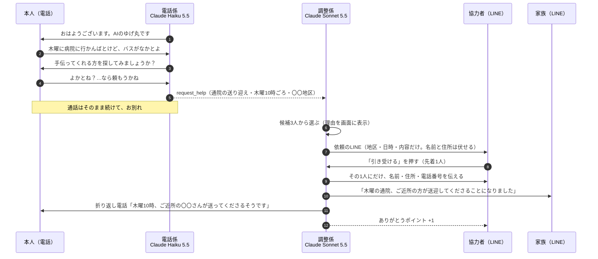

# 電話番AI 仕様書（v2.1・2026年11月3日）

> AIの見守り電話は、もうある。電話番AIは、その毎朝の会話を、地域の「ちょっと手伝って」につなぐ。

v1（毎朝の見守り電話＋家族への通知）から、**主役を「地域の助け合いのマッチング」に移した**版です。
見守り電話は2026年だけで6サービスが出ていて、そこでは差がつきません（[競合調査](./competitive-analysis.md)）。

v2.1 では、審査を想定したフィードバックをもとに、次の5点を直しました。
1. 協力者を、社会福祉協議会などの**すでにいる担い手**と位置付けた
2. 依頼にする前に、**本人の同意**を電話の中で取る
3. 調整係が**3人の候補から選ぶ理由**を、画面に見せる
4. 作る順番を決め、Claude Code の説明は1行にまとめた。MCP は読み取り専用・時間を区切って残す
5. 着信は「ゆげ丸」と表示させ、協力者を母が演じていることは字幕で明かす

---

## 1. 誰の、どんな壁を取り除くのか（テーマ2）

**雲仙市でスマホが苦手な高齢者**が、助けを受け取れずにいる。

- 雲仙市は65歳以上が15,028人（高齢化率36.4%）。一人暮らしの高齢者世帯は2,156世帯で、20年で約1.6倍（第7期雲仙市高齢者福祉計画、2024年3月）
- バスの本数が少なく、免許を返納すると通院や買い物の足がなくなる

| 壁（強い順） | いまの状態 | 電話番AIでどう変わるか |
| --- | --- | --- |
| ① スマホ・アプリが使えない | 地域の助け合いの仕組みがあっても、アプリや LINE が前提だと届かない | **毎朝かかってくる電話に出るだけ**。固定電話でも使える |
| ② 頼むのが申し訳ない（遠慮） | 「病院に行かんばとけど…」と思っても、自分からは頼まない | 雑談でこぼした一言を AI が拾い、**「手伝ってくれる人を探してみましょうか？」と聞く** |
| ③ 誰に頼めばいいか分からない | 手伝える人が近くにいても知らない | **AI が登録済みの協力者から、合う人を探して声をかける** |

### 協力者はどこから来るのか
ゼロから集めない。**すでにいる担い手の「道具」になる。**

- 社会福祉協議会のボランティア、民生委員、生活支援コーディネーター（介護保険の生活支援体制整備事業で市町村に置かれている。雲仙市の体制は要確認）
- 言い方：「電話番AIは、社協の助け合いを、電話1本で届ける道具」
- 担い手から見た価値：困りごとが「電話で聞き取られ、日時・場所・内容が整った依頼」として届く。聞き取りと調整の手間が減る

### 裏付け（今週中に集める）
| 主張 | 裏付け | 状態 |
| --- | --- | --- |
| 手伝える人は近所にいる | 社内アンケート「近所の高齢の方を手伝ってもいいか」 | 11/4 配信 |
| 遠慮して頼まない | 社内アンケート「ご家族は困ったとき近所に頼めるか」、社協・民生委員の声 | 11/4 配信／要ヒアリング |
| 担い手が使ってくれる | **雲仙市社会福祉協議会か民生委員に電話で話を聞き、ひとこと声をもらう** | **最優先** |

### 登場人物
| 役 | デモでの人 | 使うもの |
| --- | --- | --- |
| 本人 | 父（68歳、雲仙市） | 電話だけ。スマホの連絡先に「ゆげ丸」を登録しておく |
| 家族 | 離れて暮らす姉夫婦 | LINE（通知と報告を受け取る） |
| 協力者 | 母が演じる（**字幕で「協力者役：母」と明示**）。候補として架空の2人も登録 | LINE（依頼を受けて「引き受ける」を押す） |

---

## 2. 体験の流れ（主役はB）

### A. 毎朝の電話（電話係）
- 流れはv1と同じ：あいさつ → 体調 → 今日の予定 →（望めば）雑談 → お別れ。全体で1〜2分
- **困りごとが出たら、まず本人に聞く**：「手伝ってくれる方を探してみましょうか？」
  - 「よか」と言われたら、「何を・いつ・どこへ」を1つずつ聞いて `request_help` を呼ぶ
  - 「いらん」「悪かけん」と言われたら、無理に勧めない。依頼にはしない（記録だけ残す）
  - 言い方は「探してみますね。見つかったらお知らせしますね」まで。**引き受ける人が決まるまでは約束しない**
- 体調の話は今までどおり `notify_family`。緊急時は119番をすすめて、すぐに通知する

### B. 段取り（調整係・通話のあと）
1. 依頼の中身と、登録済みの協力者（できること・地区・空いている曜日）を照らし合わせ、**声をかける1人を選び、理由を書く**
   - 例：「Aさんは木曜が空いていない。Bさんは車がなく送迎できない。Cさんは同じ地区で木曜の午前が空いている → Cさん」
   - 選んだ理由と依頼文は、状況画面に表示する（デモで「Claudeが考えている」ことを見せる）
2. 協力者向けの依頼文を書いて、LINE で送る。「引き受ける」「今回は難しい」のボタンを付ける
3. 「引き受ける」で確定。「今回は難しい」なら、次の候補に声をかける
4. 確定した1人にだけ、本人の名前・住所・電話番号を送る
5. 家族に LINE で報告する
6. ゆげ丸から本人に**折り返し電話**をかけて伝える。間に合わなければ、**翌朝の電話で伝える**
7. 協力者に「ありがとうポイント」を1つ付ける
8. 全員が難しければ、家族に「見つかりませんでした」と LINE で相談する

### C. 見守りの通知（v1のまま・作成済み）
- 「体調が悪い」と言った → 通話のあと家族に1通。緊急 → その場ですぐ

### D. 家族が Claude に様子を聞ける（MCP・軽く）
- 通話の記録と依頼の状況を**読むだけ**の MCP サーバー。ツールは2つ（最近の通話のまとめ／困りごとの状況）
- 家族が Claude のアプリから「今週の父の様子は？」「木曜の通院は決まった？」と聞ける
- **作業は2時間で区切る。** 動かなければ構想として触れるだけにする

---

## 3. Claude の使い分け

| 役割 | 使うもの | 選んだ理由 |
| --- | --- | --- |
| 電話係 | Claude Haiku 5.5（effort: low） | 電話は返事の速さが大事。実測で約1.3秒（Sonnet 5.5 は約2.0秒で、間が長く感じた） |
| 調整係 | Claude Sonnet 5.5 ＋ ツール（候補を調べる・LINE を送る・家族に報告・折り返し電話） | 通話のあとに動くので、速さより判断の質を優先。誰に頼むか、どう書けば引き受けやすいかを考え、理由を残す |
| 安全テスト | テスト用の場面（まず20件）＋ Claude で採点 | 「医療の助言をしない」「119番をすすめる」「同意なしに依頼しない」「約束しない」「個人情報を聞かない」を毎回自動で確かめる |
| 様子を聞く | MCP サーバー（読み取り専用） | §2-D |
| 開発 | Claude Code | 「プログラミング初心者の自分が5日で、電話・LINE・AIをつなぐシステムを作れた。その過程は PR の履歴に残っている」 |

---

## 4. 安全の設計

| 心配 | 決めたこと |
| --- | --- |
| 本人が望まない依頼 | **本人が「頼む」と言ったときだけ**依頼にする。断られたら勧めない |
| 知らない人が家に来る | 協力者は社協などで確認済みの人だけを登録する（デモは家族が演じる） |
| 個人情報が広がる | 依頼の段階では地区・日時・内容だけ。**名前・住所・電話番号は、引き受けた1人にだけ**渡す |
| 送迎と法律 | 送迎は**無償**（ガソリン代などの実費のみ）。一般の人が対価を受けて送迎すると道路運送法の許可が要るおそれがあるため、**ありがとうポイントを地域通貨にするときは送迎を対象外にするか、法律を確認する**（要確認） |
| 事故のとき | 社協のボランティア活動保険に入っていることを前提にする（要確認） |
| お金のトラブル | お金の受け渡しはサービスが扱わない |
| AI ができない約束をする | 引き受ける人が決まるまで、AI は「探してみますね」までしか言わない |
| 医療の判断 | 体調の話は聞いて家族につなぐだけ。診断・薬・受診の判断はしない。緊急時は119番 |
| 詐欺と間違われる | AI であることを毎朝名乗る。お金・口座・暗証番号は聞かない。デモの着信は「ゆげ丸」と表示させる（アメリカの番号からかかるため） |
| テスト中の誤送信 | LINE の送り先を環境変数で絞る（家族・協力者ごとにユーザーIDを登録） |

---

## 5. お金の回り方
- 原価は1人あたり月1,800〜3,300円（毎日3分。大半は通話料。[競合調査](./competitive-analysis.md)）
- 払うのは**自治体や社協からの委託**を基本にする（郵便局の見守りは自治体の交付金で導入された例がある）
- 家族が払う月額プランは、Care-Call.AI（3,980円〜）と同じか少し下

---

## 6. 作る順番（上から必ず動かす）

| 順 | 内容 | 間に合わないとき |
| --- | --- | --- |
| 1 | 電話の中で同意を取り、`request_help` で依頼にする | ―（ここは必須） |
| 2 | 調整係が3人の候補から選び、理由と依頼文を残す。協力者に LINE で依頼が届き、「引き受ける」を押せる | ― |
| 3 | 家族に LINE で報告。状況画面に選んだ理由を表示 | 報告は画面だけ |
| 4 | Twilio で電話につなぐ（着信は「ゆげ丸」表示） | ブラウザの通話画面で見せる |
| 5 | 折り返し電話 | 翌朝の電話で伝える |
| 6 | 安全テスト（まず20件） | 件数を減らす |
| 7 | MCP（読み取り専用・2時間） | 構想として触れる |
| 済 | 体調の見守り通知（v1） | ― |
| 後回し | 電話に出ないときの再発信、毎朝の自動発信 | デモでは手でかける |
| 構想のみ | 詐欺の相談、災害時の安否確認、昔の知恵の記録、地域通貨 | ― |

### データ（Supabase）
- `calls`：通話の記録（体調・予定・まとめ）
- `help_requests`：困りごと（内容・日時・場所・同意の有無・状態：探している／決まった／見つからない）
- `helpers`：協力者（呼び名・できること・地区・空いている曜日・LINE のユーザーID・ポイント）
- `offers`：誰に声をかけたか、選んだ理由、返事（引き受ける／難しい）

---

## 7. デモ動画（3分）

| 時間 | 場面 | 見せたいこと |
| --- | --- | --- |
| 0:00〜0:20 | 父の暮らし。スマホは苦手、バスは少ない。雲仙市の数字 | 誰の、どんな壁か |
| 0:20〜0:45 | 朝、父の電話に「ゆげ丸」から着信。「腰が痛か」→ 姉の LINE に届く | 見守りは土台（25秒で済ませる） |
| 0:45〜2:10 | 「木曜に病院に行かんばとけど…」→「探してみましょうか？」→「よかとね？…なら頼もうかね」→ 調整係が3人から選ぶ理由が画面に → 協力者（字幕：協力者役・母）の LINE に依頼 →「引き受ける」→ 姉に報告 → ゆげ丸から父に折り返し電話 | **主役。遠慮の壁を越える瞬間** |
| 2:10〜2:40 | 電話係（Haiku・1.3秒）と調整係（Sonnet）の図。安全テストの結果。家族が Claude に「今週の父は？」と聞く場面（MCP） | Claude の活用 |
| 2:40〜3:00 | 社協・民生委員の声。協力者の輪が広がる絵 | ハッカソン後も続く形 |

---

## 8. まだ決めていないこと・確かめること
- **社協か民生委員へのヒアリング（最優先）**
- 雲仙市の生活支援コーディネーターの体制
- 送迎と道路運送法、ボランティア保険の扱い
- Twilio（アメリカの番号）から日本の携帯に電話が届くか（早めに1回試す）
- サービス名（社内アンケートで投票：アサコエ／見守りコール／おはようでんわ／どがんねコール／もしもしさん）
